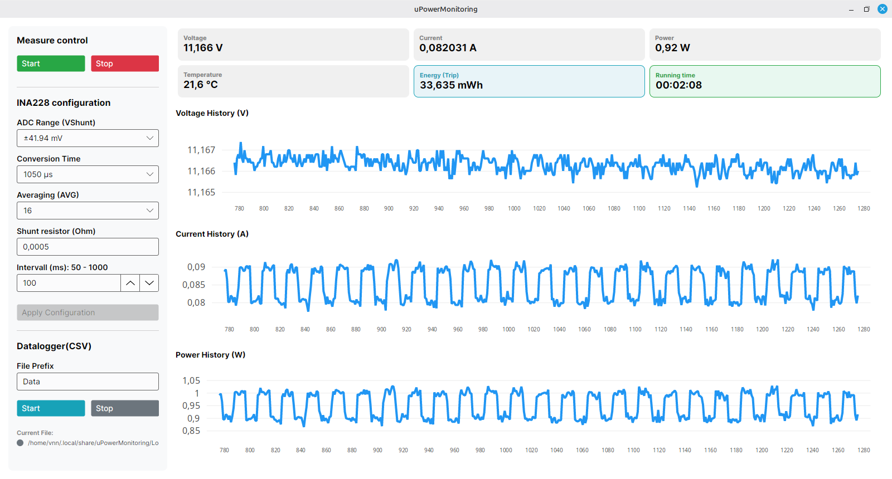

# uPowerMonitoring

A robust, cross-platform (Windows & Linux) desktop application built with **Avalonia UI** and **.NET** for real-time power monitoring, high-precision energy calculation ($mWh$), and automated CSV logging using the **INA228** sensor connected via the **FTDI UM232H** (MPSSE / I2C).



---

## 🚀 Key Features

* **Real-Time Dashboard:** Clean $3\times2$ grid layout displaying live telemetry (Voltage, Current, Power, Temperature) and a high-precision energy trip counter ($mWh$).
* **Precise Energy Calculation:** Integrates power over time using high-resolution time deltas (`Stopwatch`) and the formula:
  $$\text{Energy}_{\text{step}} = \frac{\text{Power (W)} \times \Delta t (\text{ms})}{3600.0}$$
* **Configurable INA228 Sensor Settings:** Adjust parameters dynamically from the UI:
  * Shunt Resistance (e.g., $0.001\,\Omega$)
  * ADC Range ($\pm 40\,\text{mV}$ to $\pm 160\,\text{mV}$)
  * Conversion Time & Averaging (AVG)
  * Sampling Interval ($20\,\text{ms}$ to $1000\,\text{ms}$)
* **Automated CSV Data Logging:** Records measurement sessions into platform-independent system folders (`Environment.SpecialFolder.LocalApplicationData`), complete with a detailed session header containing active hardware settings.
* **Cross-Platform:** Native performance and appearance on both Windows and Linux.

---

## 🛠️ Tech Stack

* **Framework:** [.NET 10.0](https://dotnet.microsoft.com/)
* **UI Framework:** [Avalonia UI](https://avaloniaui.net/)
* **MVVM Architecture:** [CommunityToolkit.MVVM](https://github.com/CommunityToolkit/dotnet)
* **Charting:** [LiveCharts2](https://livecharts.dev/)
* **Hardware Communication:** **FTDI UM232H** (FT232H chip utilizing MPSSE for high-speed I2C master communication via FTD2XX).

---

## 📋 Hardware Setup & Communication

* **Sensor:** Texas Instruments INA228 (High-Precision Digital Power Monitor)
* **Bridge Module:** **FTDI UM232H** (USB-to-I2C via MPSSE interface)
* **Driver:** FTDI D2XX drivers (`libftd2xx` on Linux, native DLL on Windows).
* **Typical Operational Parameters:** 
  * Voltage: $\sim 11.2\,\text{V}$
  * Current: $70\text{--}90\,\text{mA}$
  * Sampling Rate: $50\,\text{ms}$ to $1000\,\text{ms}$

---

## ⚙️ Getting Started

### Prerequisites
* [.NET SDK](https://dotnet.microsoft.com/download) (10.0 newer)
* FTDI D2XX drivers installed on your system.

### Cloning and Running
1. Clone the repository:
   ```bash
   git clone https://github.com/your-username/uPowerMonitoring.git
   cd uPowerMonitoring
   ```

2. Build and run the project:
   ```bash
   dotnet restore
   dotnet run --project uPowerMonitoring
   ```

---

## 📁 CSV Data Logger Output Format

The application automatically creates a subfolder in your local application data directory:
* **Windows:** `C:\Users\<User>\AppData\Local\uPowerMonitoring\Logs\`
* **Linux:** `/home/<user>/.local/share/uPowerMonitoring/Logs/`

Each generated CSV file includes a comprehensive header containing the active session configuration followed by standard telemetry columns:
```csv
Datalogger uPowerMonitoring
INA228 Settings:
ADC range: ±40 mV
Conversion time: 1050 µs
Average: 16
Sample interval: 50ms
Shunt resistor: 0.001 Ohm

Index; Voltage_V;Current_A,Power_W,Temperature_C
1;11.231;0.0812;0.912;24.5
2;11.230;0.0809;0.910;24.5
```

---

## 📄 License

This project is open-source under the [MIT License](LICENSE).